
<picture><source media="(max-width: 650px)" srcset="assets/profile/hero-mobile-ptbr.svg"></picture>

## Sobre mim

Sou desenvolvedor **Full Stack** e estudante de **Sistemas de Informação na UFSM**. Gosto de transformar problemas em aplicações reais. Tenho interesse especial em **backend**, APIs, arquitetura de serviços, dados e integração de inteligência artificial.

Atuei no desenvolvimento de uma plataforma **SaaS usada por mais de 1.500 empresas**, trabalhando em funcionalidades, APIs e testes automatizados. Na iniciação científica da UFSM, trabalho com **ingestão e validação de dados** e ferramentas de IA.

## Projetos em destaque

### 

[](https://github.com/LeonardoBalk/tessera)

**Plataforma de eventos e ingressos** com diferentes perfis de acesso. Trabalhei nas regras de reserva e nas transações atômicas que evitam conflitos na venda de assentos. Também trabalhei nos ingressos com **QR Code assinado por HMAC** e na pesquisa de eventos em linguagem natural.

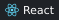 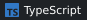 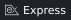  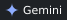

 

### 

[](https://github.com/LeonardoBalk/healthlens)

Plataforma para explorar conjuntos de dados de saúde em **CSV, JSON e XLSX**, com estatísticas, painéis interativos e consultas em linguagem natural com IA.

   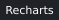 

 

*A base de demonstração pode estar pausada.*

### DECSYS


Pesquisa e desenvolvimento de uma plataforma de **ingestão, tratamento e validação de dados**, conectando APIs, armazenamento e publicação de indicadores. Atuação com Python, FastAPI e interfaces web.

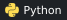 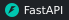 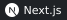  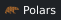

*Repositório privado.*

### 

[](https://github.com/LeonardoBalk/agentes)

Sistema experimental com um **agente de IA** para apoiar a análise e a simulação de cenários fiscais. O projeto combina ferramentas de análise com validação humana.

 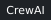 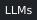

<b>Outros projetos e colaborações</b>

- **[Trivia Anatômica](https://github.com/elc1074/Trivianatomica)** - projeto acadêmico colaborativo de aprendizagem com trilhas, questões e flashcards.
- **[Assistente Neurocom](https://github.com/LeonardoBalk/assistente-neurocom)** - backend conversacional com RAG, autenticação e comunicação em tempo real.
- **[Kanban Tarefas](https://github.com/LeonardoBalk/kanban-tarefas)** - aplicação com Go, React, arrastar e soltar e Docker.
- **[API de Irrigação](https://github.com/LeonardoBalk/API-Gerenciamento-de-Irrigacao)** - API REST com autenticação JWT e controle de permissões.

## Experiência

**Iniciação científica · DECSYS / UFSM** - *set/2026 – atual*  
Desenvolvimento de fluxos de dados, validação e integrações com APIs e modelos de IA, usando Python, FastAPI e ferramentas do ecossistema web.

**Estagiário Full Stack · Ouvidor Digital** - *jan/2026 – nov/2026*  
Desenvolvimento e manutenção de plataforma SaaS, criação de funcionalidades e APIs, revisão de código, correções e testes automatizados com Vitest e Playwright.

<b>Experiências anteriores</b>

- **LAMIC / UFSM** - desenvolvimento web e suporte de TI (2025–2026).
- **Neurocom** - desenvolvimento de assistente conversacional com RAG (2025).
- **CCSH / UFSM** - suporte técnico e infraestrutura (2024–2025).

## Tecnologias

**Linguagens e frontend**

**Backend, dados e ferramentas**

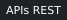 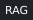 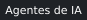  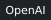 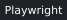  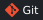

## Formação

**Sistemas de Informação - UFSM** · 2023–2027, em andamento  
**Técnico em Administração - IFFar** · 2020–2022

## Contato

